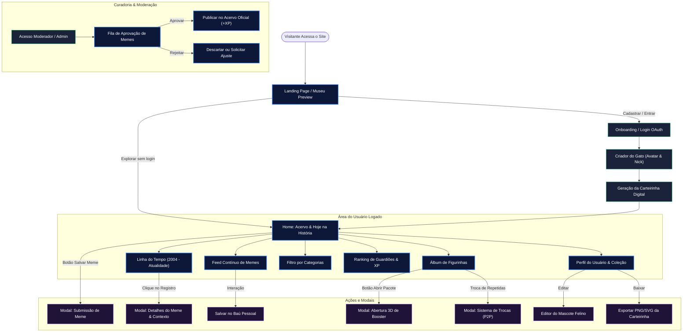
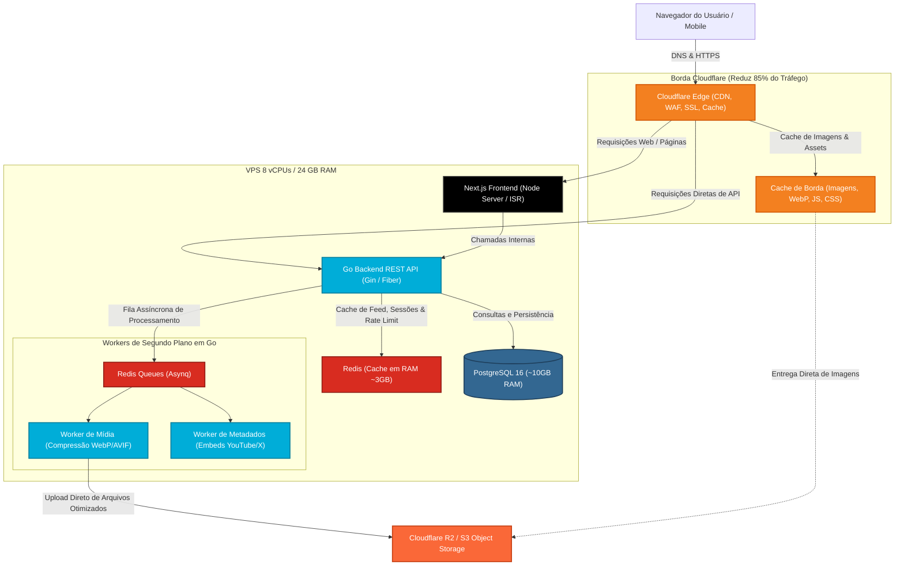
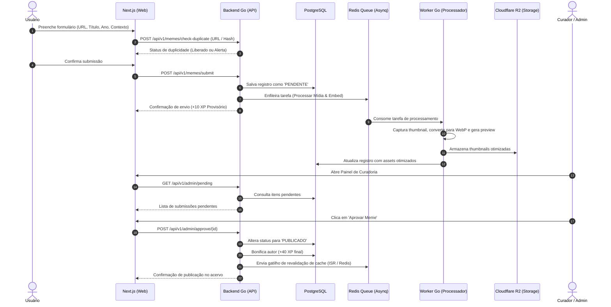
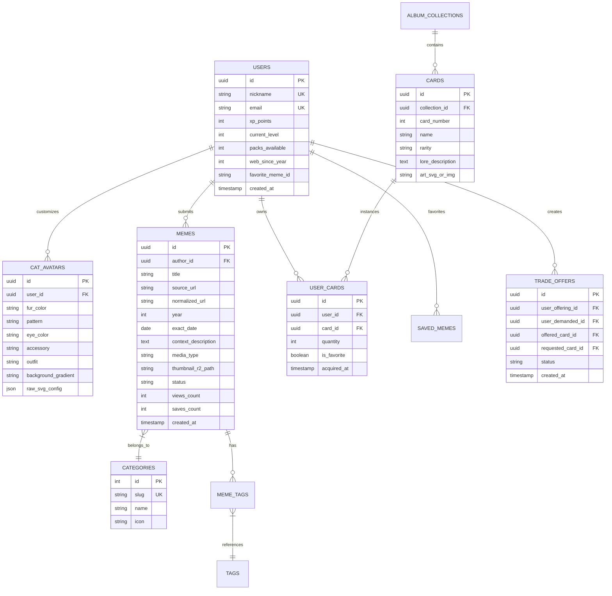

# 🏛️ NÃO SALVO — Museu & Arquivo da Internet Brasileira

> *"E no fim, o plano do Não Salvo era salvar."*

O **Não Salvo** é uma plataforma colaborativa dedicada a catalogar, preservar e celebrar a história viva dos memes, virais e da cultura digital brasileira desde 2004 até a atualidade.

Este projeto nasceu da união da comunidade (comunidade XET, Cid Cidoso, moderadores e voluntários) para criar uma experiência rica que mistura acervo histórico, linha do tempo interativa e gamificação através de um álbum de figurinhas digital.

---

## 📌 Sumário
- [1. Visão Geral e Funcionalidades (MVP)](#1-visão-geral-e-funcionalidades-mvp)
- [2. Mapas e Diagramas Mermaid](#2-mapas-e-diagramas-mermaid)
  - [2.1. Mapa de Telas e Navegação](#21-mapa-de-telas-e-navegação)
  - [2.2. Arquitetura do Sistema e Infraestrutura](#22-arquitetura-do-sistema-e-infraestrutura)
  - [2.3. Fluxo de Submissão e Processamento de Mídia](#23-fluxo-de-submissão-e-processamento-de-mídia)
  - [2.4. Modelo de Dados (ER Diagram)](#24-modelo-de-dados-er-diagram)
- [3. Stack Tecnológica e Dimensionamento](#3-stack-tecnológica-e-dimensionamento)
- [4. Estrutura de Diretórios Recomendada](#4-estrutura-de-diretórios-recomendada)
- [5. Regras de Negócio e Curadoria](#5-regras-de-negócio-e-curadoria)
- [6. Referências de Design e Mockups](#6-referências-de-design-e-mockups)

---

## 1. Visão Geral e Funcionalidades (MVP)

### 🗓️ 1. Hoje na História da Internet ("Hoje há X anos")
- Compara a data atual (dia e mês) com os registros do acervo em anos anteriores.
- Apresenta carrossel com acontecimentos e memes que viralizaram exatamente na data ou no mesmo mês há 5, 10, 15 ou 20 anos atrás.
- Atalho direto para viajar no tempo até o ano específico.

### ⏱️ 2. Linha do Tempo Histórica (2004 - Presente)
- Navegação ano a ano com lema e resumo cultural de cada época (ex.: *2004: O ano do Orkut*, *2007: Tropa de Elite vaza*, *2012: O caos do Facebook e Gangnam Style*, *2014: O 7x1*).
- Grade de registros com filtros por categoria (Vídeos, Música, TV, Zoeira, GIFs, Fotos, Jogos, Política).
- Classificação por raridade cultural: *Clássico*, *Relíquia*, *Lendário* e *Mítico*.

### 🎞️ 3. Feed Multimídia & Baú do Usuário
- Feed vertical contínuo com reprodução otimizada de mídias (YouTube, TikTok, X/Twitter, Instagram, arquivos diretos WebM/MP4).
- Navegação rápida via teclado (`↑`/`↓` para navegar, tecla `S` para salvar no baú pessoal).
- Histórias de bastidores: campo *"Conta pra quem não viveu"* contextualizando a piada original.

### 🃏 4. Álbum de Figurinhas da Internet (Gamificação)
- Coleções temáticas (ex.: *Fotolog Legends*, *Orkut Legends*, *TV & Bordões*, *Clássicos do YouTube*).
- Níveis de raridade: Comum, Relevante, Raro, Relíquia, Lendário e Mítico.
- **Pacotes Diários (Booster Packs):** abertura de pacotes com animação 3D flip e efeitos sonoros.
- **Reciclagem de Repetidas:** 5 cartas repetidas viram 1 novo pacote.
- **Sistema de Trocas (Trades):** mural e links diretos para propor trocas entre usuários.

### 🐱 5. Criador de Avatar (Gatopeixe) & Carteirinha de Membro
- Construtor modular em SVG do mascote felino: cor de pelo, padrões (tigrado, frajola, liso), olhos, acessórios (óculos escuros, boné, fone, bandana), roupas e fundos.
- Carteirinha digital com Nick, ano em que começou a navegar na web, meme favorito e selo de membro fundador, disponível para download e compartilhamento em redes.

### ☁️ 6. Submissão Aberta com Anti-Duplicação
- Envio de novos memes pela comunidade com detecção em tempo real de links e títulos já cadastrados.
- Fila de moderação para os guardiões do acervo (Cid, Sepp e equipe de curadores).
- Recompensa em XP (+50 XP por meme aprovado, +5 XP por expansão do álbum).

---

## 2. Mapas e Diagramas Mermaid

### 2.1. Mapa de Telas e Navegação



---

### 2.2. Arquitetura do Sistema e Infraestrutura



---

### 2.3. Fluxo de Submissão e Processamento de Mídia



---

### 2.4. Modelo de Dados (ER Diagram)



---

## 3. Stack Tecnológica e Dimensionamento

### 🚀 Stack Principal
| Componente | Tecnologia | Papel Principal |
| :--- | :--- | :--- |
| **Borda & CDN** | Cloudflare Enterprise/Pro + WAF | Cache estático agressivo, proteção DDoS e proxy |
| **Storage de Mídia** | Cloudflare R2 | Armazenamento S3-compatible com taxa de saída de dados (egress) zerada |
| **Frontend** | Next.js (App Router, React, TailwindCSS) | Páginas com ISR (Incremental Static Regeneration) e navegação client-side rápida |
| **Backend API** | Go (Golang) com Gin ou Fiber | API REST leve, concorrência nativa de alto desempenho e baixo uso de RAM |
| **Filas & Cache** | Redis 7 + Asynq (Go) | Cache de feeds, controle de sessões e filas de background para imagens |
| **Banco de Dados** | PostgreSQL 16 com extensão `pg_trgm` | Persistência relacional, busca textual rápida e integridade |

---

### ⚙️ Alocação de Recursos (VPS 8 vCPUs / 24 GB RAM)
Para evitar que picos derrubem o servidor por esgotamento de memória (*OOM Killer*), a distribuição de memória é isolada:

```
+---------------------------------------------------------------+
|                      VPS CONTABO 24 GB RAM                    |
+-------------------+--------------------+----------------------+
| PostgreSQL 16     | Next.js (Cluster)  | Redis (LRU Cache)    |
| ~10 GB RAM        | ~4 GB RAM          | ~3 GB RAM            |
| (shared_buf: 6GB) | (Node multi-core)  | (allkeys-lru)        |
+-------------------+--------------------+----------------------+
| Go API + Workers  | Linux Kernel & SO  | Margem de Segurança  |
| ~2 GB RAM         | ~3 GB RAM (Buffer) | ~2 GB RAM            |
+-------------------+--------------------+----------------------+
```

### ⚡ Estratégia de Escalabilidade (Até 30.000 usuários simultâneos)
1. **ISR no Next.js:** páginas de anos passados e coleções são pré-geradas e cacheadas na Cloudflare.
2. **Processamento Desacoplado:** o upload de imagens/vídeos nunca bloqueia a requisição HTTP; o backend coloca a tarefa na fila do Redis e os workers em Go realizam redimensionamento e conversão WebP em segundo plano.
3. **Cache de Borda na Cloudflare:** mais de 85% das requisições de mídias e páginas públicas não chegam ao disco nem à CPU da VPS.

---

## 4. Estrutura de Diretórios Recomendada

```plaintext
naosalvo/
├── .github/
│   └── workflows/              # CI/CD para build, testes e deploy
├── apps/
│   ├── web/                    # Frontend Next.js (App Router)
│   │   ├── src/
│   │   │   ├── app/            # Rotas: /, /timeline, /feed, /album, /admin
│   │   │   ├── components/     # UI, Player, Avatar Builder, Pack Modal
│   │   │   ├── hooks/          # Consumo de dados e estado local
│   │   │   └── lib/            # Clientes de API e utilitários de data/svg
│   │   ├── public/
│   │   ├── package.json
│   │   └── next.config.mjs
│   │
│   └── api/                    # Backend Go
│       ├── cmd/
│       │   ├── server/         # Ponto de entrada da API HTTP
│       │   └── worker/         # Processador assíncrono de filas (Asynq)
│       ├── internal/
│       │   ├── handler/        # Controladores HTTP (memes, album, users)
│       │   ├── service/        # Regras de negócio, XP e trocas
│       │   ├── repository/     # Queries SQL (Postgres / pgx)
│       │   └── queue/          # Produtores e consumidores de tarefas
│       ├── pkg/
│       │   └── avatar/         # Gerador procedural de avatares SVG
│       ├── go.mod
│       └── go.sum
│
├── deploy/
│   ├── docker-compose.yml      # Orquestração local e produção
│   ├── nginx/                  # Configurações de reverse proxy (se aplicável)
│   └── postgres/
│       └── init.sql            # Scripts de schema inicial e migrações
│
├── docs/
│   ├── references/             # HTMLs dos protótipos originais de referência
│   └── architecture/           # Detalhes de infraestrutura e API
│
└── README.md
```

---

## 5. Regras de Negócio e Curadoria

1. **Submissão e Prevenção de Duplicatas:**
   - Ao colar um link (YouTube, TikTok, X, etc.), o sistema normaliza parâmetros de rastreamento (`utm_*`, `si=`, etc.) e verifica no banco.
   - O título passa por checagem fonética/similaridade de texto (`similarity` no PostgreSQL) para sugerir itens existentes.
2. **Ciclo de Moderação:**
   - Memes enviados entram como `PENDENTE`.
   - Moderadores podem: aprovar, rejeitar com justificativa, ou editar categoria/ano/contexto.
3. **Gamificação e Recompensas:**
   - Cada login diário concede 1 pacote de cartas.
   - Submissão aprovada garante +50 XP.
   - Cartas repetidas podem ser recicladas (proporção 5:1).
   - O ranking lista os maiores guardiões da memória nacional.

---

## 6. Referências de Design e Mockups

Os protótipos conceituais desenvolvidos pela comunidade estão catalogados na pasta [`docs/references/`](file:///docs/references/):
- **Mockup Geral & Linha do Tempo:** [`docs/references/riba_main.html`](file:///docs/references/riba_main.html)
- **Álbum de Figurinhas Digital:** [`docs/references/riba_album.html`](file:///docs/references/riba_album.html)
- **Conceito Completo com Feed & Avatar:** [`docs/references/cid_ideia.html`](file:///docs/references/cid_ideia.html)

---

### 🤝 Como Contribuir
Consulte os responsáveis pelo repositório (`@SePPZAO`, `@cidcidoso`) para alinhamento nas issues e branches de desenvolvimento.
